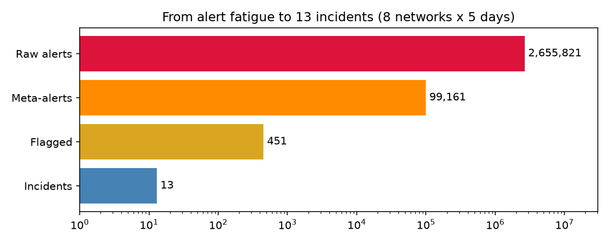
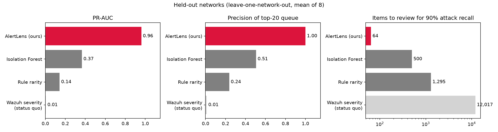
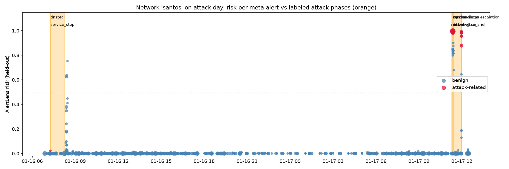

# AlertLens — pitch (5 slides, ~3 min + live demo)

## 1. The problem: alert fatigue
- One mid-size network, 5 days: **~330K IDS alerts** (Wazuh + Suricata + AMiner). 8 networks: 2.66M.
- The real multi-step attack (scan → WordPress exploit → webshell → cracking → reverse shell → root) is **0.45%** of it.
- Severity is useless for triage here: sorting by Wazuh level, an analyst reviews **12,017 items** to catch 90% of the attack.

## 2. AlertLens: from 2.66M alerts to 13 incidents
1. Normalize 3 sensors into one schema → **deduplicate** into 99K meta-alerts.
2. **Behavioral feature calcers** (streaming-safe, label-free): is this rule new *for this network*? is this IP new?
   how many independent sensors corroborate? how bursty?
3. **LightGBM ranker**, validated *leave-one-network-out* — every number is on a network it never saw.
4. **Explain**: SHAP → plain-English reasons, kill-chain stage + MITRE ATT&CK, incident chaining.
5. **Local LLM analyst** (Ollama, qwen3:14b): writes the incident report, answers questions. No telemetry leaves the SOC.

## 3. Results (held-out networks, no look-ahead)
- PR-AUC **0.96** vs 0.37 (Isolation Forest) vs 0.006 (Wazuh severity).
- Top-20 queue **100% precision**; queue for 90% recall **64 items vs 12,017** → **99.9% of benign alerts suppressed**.
- 451 flagged at **91% precision** (~98% counting attack traffic the labels miss); only 10 benign items outside any attack.
- **#1 incident = the real attack in 8/8 networks**; 88% of attack phases surfaced; stage accuracy 90%.
- The AI analyst doesn't rubber-stamp: 9/9 real attacks → TRUE POSITIVE, 4/4 benign incidents → LIKELY BENIGN / NEEDS REVIEW.

## 4. Why it works (and isn't cheating)
- Ablation: knowing *what* a rule is → PR-AUC 0.49; knowing *how it behaves in this network* → 0.96.
- Remove all time-window context features → only −0.02: it's not learning "when the attack was".
- Streaming-safe vs retrospective features: 0.933 vs 0.938 — works live.
- Reads the raw logs like an analyst: `www-data` switching user, `/etc/shadow` access, shells with no login → attack;
  SSH key logins from `/home/admin` → benign. Flagged false positives 77 → 41.
- Tuning checked for selection bias (nested leave-one-network-out): 0.961 holds.
- Every alert shows **baseline, learning period and the why**: a 24 h learning period per network, "this alert vs.
  normal here" for each driving signal, and a SHAP waterfall from the typical-alert prior to its score — computed by
  the same held-out models, so it explains exactly the number the analyst sees.
- Label denoising: in-window background noise (mail logins, TLS chatter) is not counted as attack.
- Honest limitation: DNS exfiltration hides in a detector that fires all day → next: per-domain sequence features.

## 5. Live demo
Overview → Incident queue (santos #1: kill-chain timeline + AI report) → Ask the analyst ("which IP do I block
first?") → Why suspicious? (fox top alert: baseline vs. now + waterfall; russellmitchell admin SSH login: rare but benign) → Alert triage (mark admin `sudo` as FP → suppressed) → Ground truth view.
