# AlertLens

**Find the real attack in millions of security alerts, and explain why it is suspicious.**

*AIC × CrowdStrike Hackathon · Track 2: Detect (AI-powered Blue Team)*

AlertLens takes the **2.66 million** alerts that three security sensors (Wazuh, Suricata, AMiner) raised across
8 company networks in the [AIT Alert Data Set](https://zenodo.org/records/8263181), and turns them into
**13 ranked incidents**. Each one comes with a kill-chain timeline, the reasons it is suspicious, MITRE ATT&CK
techniques, and an incident report written by an LLM that runs locally.

| | |
|---|---|
| Items an analyst reviews to catch 90% of the attack | **64** instead of 12,017 (sorting by severity) |
| Ranking quality (PR-AUC, 1.0 = perfect) | **0.96** (generic anomaly detector: 0.37, severity: 0.006) |
| Top 20 of the queue that are real attack | **100%** |
| Networks where incident #1 is the real attack | **8 of 8** |

Every number is measured on a network the model **never trained on**, using only alerts from **before** the one being
scored, so this is what you would get running live at a new company.

> **Slides:** [`Presentation.pptx`](Presentation.pptx) is our pitch deck. [`presentation/AlertLens.pptx`](presentation/AlertLens.pptx) is the extended version that explains the whole solution in plain
> language and follows one real attack from raw log line to AI report.

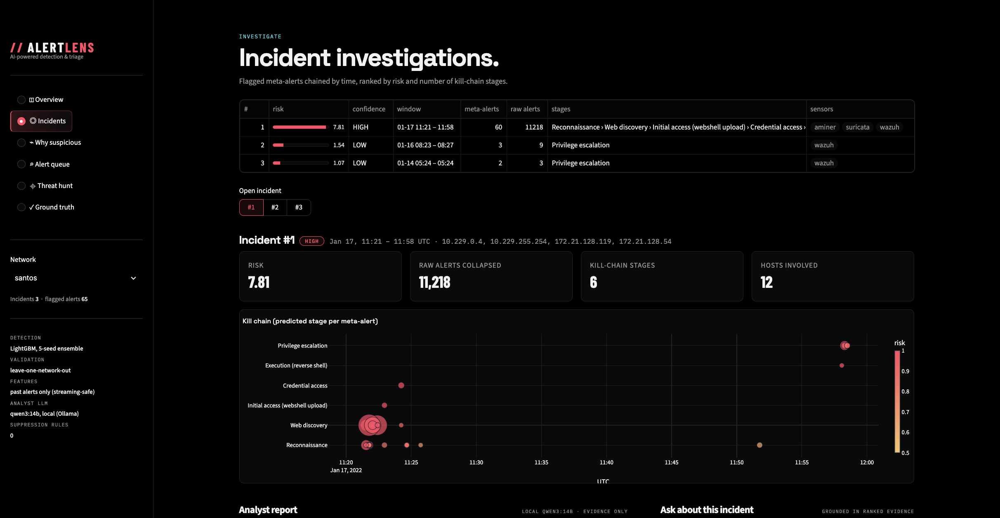

---

## The problem: alert fatigue

A SOC (Security Operations Center) gets far more alerts than people can check. Here is one network: 130,779 alerts in
4 days. The real attack (red) does not stand out by volume; normal activity makes bigger bursts every day.

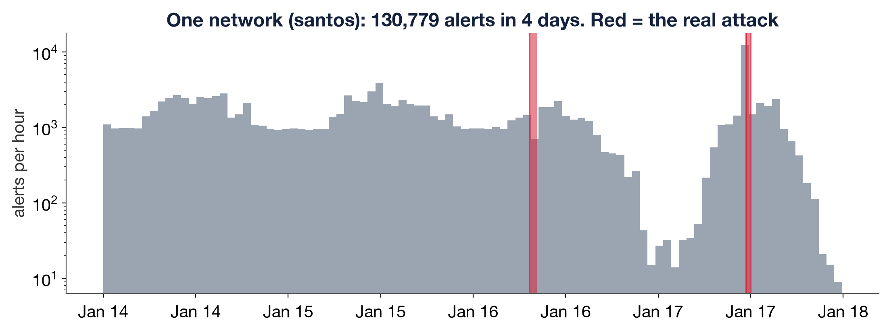

Sorting by severity does not help either: attack and normal alerts have the same severity levels. Dangerous steps like
"the web server switched to a real user account" are routine level-3 events.

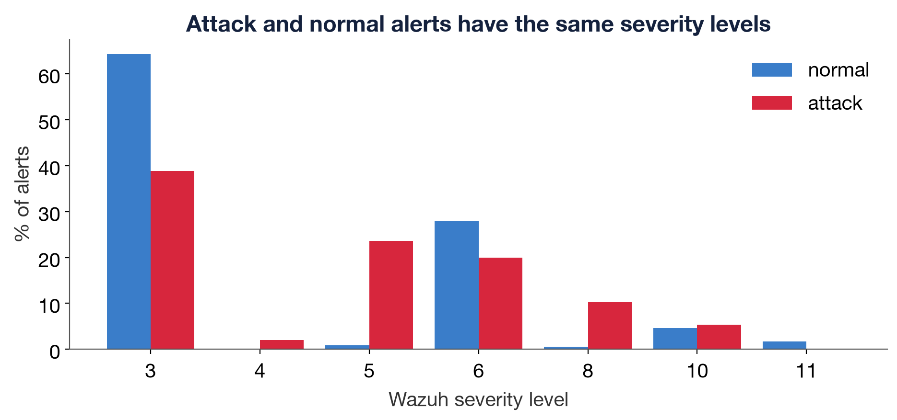

---

## How it works, step by step

### 1. Collect and merge duplicates

All 16 JSON files (Wazuh host alerts, Suricata network alerts, AMiner log anomalies) go into one table. One attacker
action can fire the same rule thousands of times, so alerts with the same **network + host + rule + source IP**, no more
than 5 minutes apart, become one **meta-alert**. For example, the attacker's website scanner made 7,155 alerts in a few
minutes; they become 1.

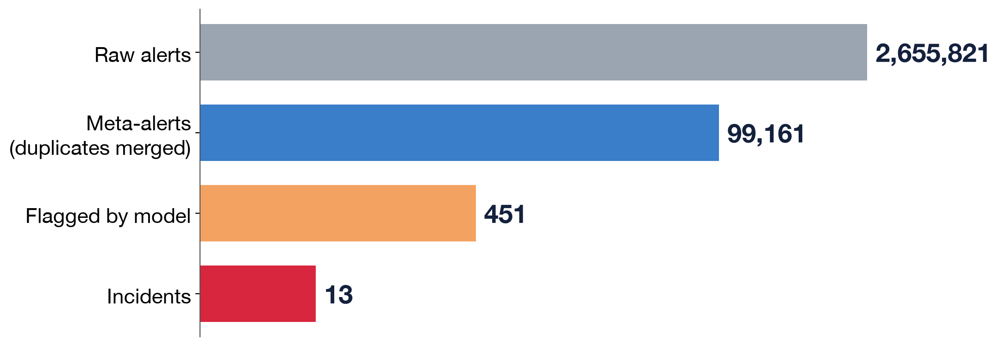

### 2. Ask the questions an analyst would ask

The model never sees raw IPs or hostnames. Every meta-alert gets ~100 numbers (**features**), each answering a
question like *"has this rule fired here before?"* or *"what else unusual is happening right now?"*. They are computed
by small pluggable blocks called **calcers**, using only alerts from earlier:

| Calcer | Question it answers |
|---|---|
| `rule_rarity_causal` | Has this rule fired in this network before? In what share of past hours? |
| `context` | What else is happening network-wide in the same 10 minutes: how many rare rules, hosts, sensors? |
| `src_ip_causal` | Is this source IP new? How many hosts and rules has it touched? |
| `burst` | How big and fast is this burst (alerts, duration, distinct URLs, users, ports)? |
| `log_content` | Do the raw logs show attacker behaviour (`www-data` switching user, `/etc/shadow`, PHP in `uploads/`, scanner user agents) or admin behaviour (SSH key logins, commands from `/home`)? |
| `account` | Is this user account new on this host or in this network? |
| `semantics` | What kind of rule is it (authentication, web, MITRE tactic, log source)? |

Attack alerts look very different on these questions. Blue is normal, red is attack:

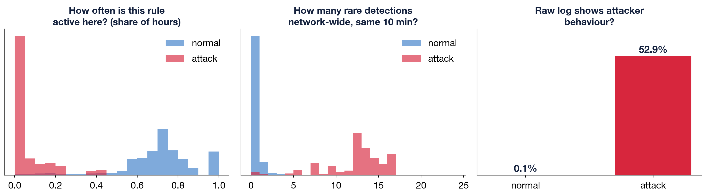

### 3. The model learns which answers mean "attack"

We show the model examples from 7 networks together with the answer key, and it finds the questions that separate
attack from normal by itself. Here is a tiny tree it learned: *many rare detections at once AND a rule that is rarely
active here → attack.*

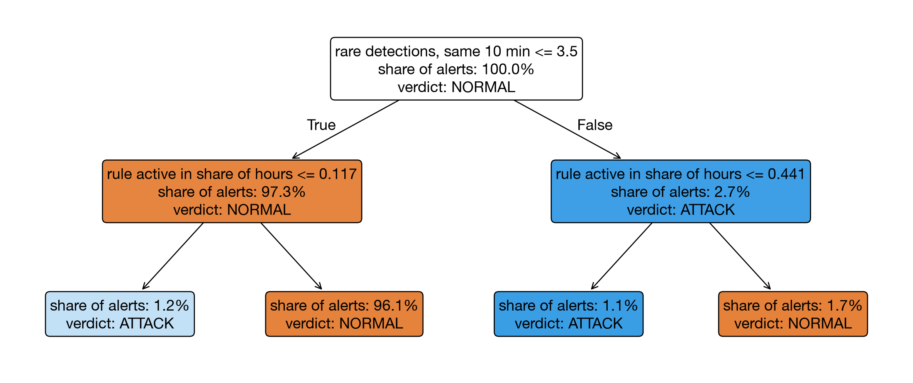

The real model, **LightGBM**, builds 800 small trees like this one after another, each fixing the mistakes of the
previous ones. Rare attack examples get extra weight, and 5 copies with different random seeds are averaged.

### 4. The honest test: a network the model has never seen

We hold out one whole network, train on the other 7, score the held-out one, and repeat 8 times. This is
**leave-one-network-out** validation, the same situation as installing AlertLens at a new customer.

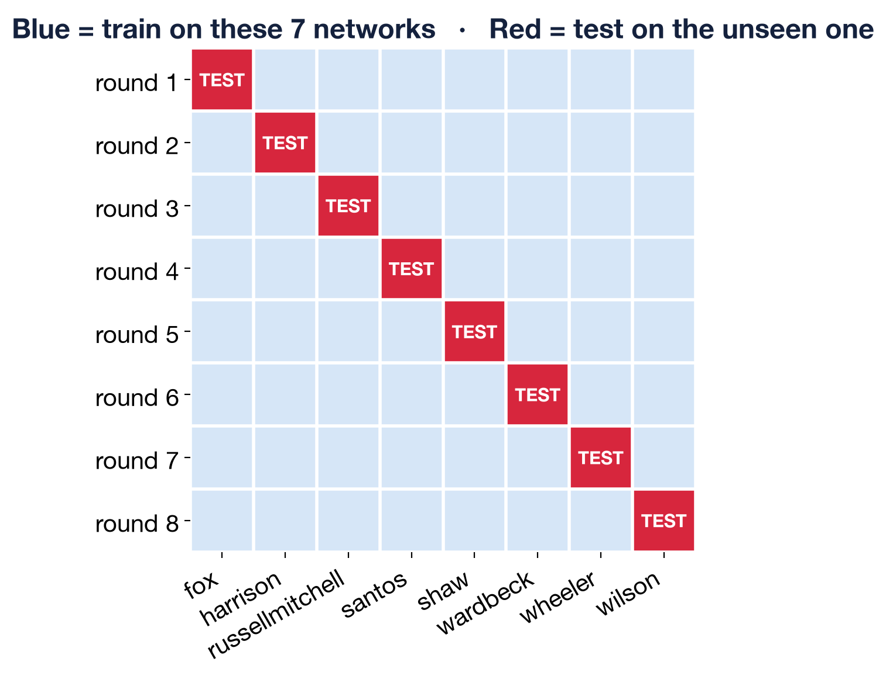

### 5. Results

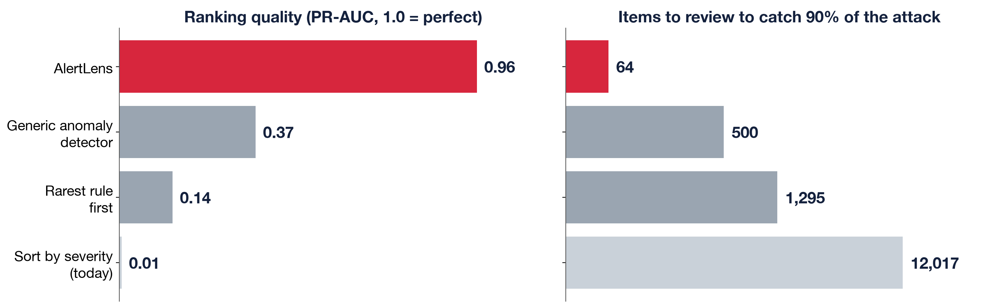

### 6. A real attack, step by step (santos, 17 January)

The attacker scans the network and the website, uploads a backdoor (webshell) through WordPress, cracks a password,
opens a remote shell, and finally the web-server account `www-data` switches to the real user `gmorgan` and runs
`sudo`. Each alert alone is low severity. AlertLens links **11,218 raw alerts into one incident with 6 stages**,
ranked #1 in santos with confidence HIGH.

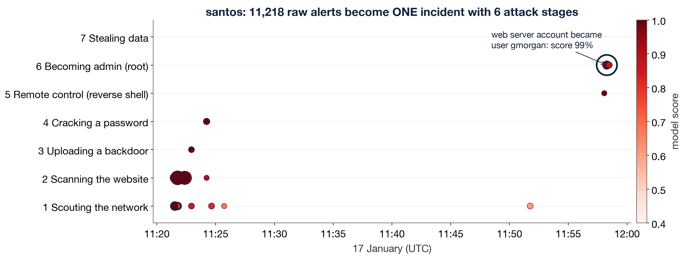

### 7. Why is it suspicious? Baseline, learning period, and the reasons

The first **24 hours** of each network are its **learning period**: this is how AlertLens learns what normal looks like
(no attack starts before hour 46 in any network). For every alert, the dashboard shows what's normal here next to this
alert, plus a **SHAP** breakdown: how much each reason pushed the score up or down, from a typical alert (~0.002%) to
the final score. The numbers add up exactly to the score the analyst sees.

| Question | Normal in santos | This alert | Push |
|---|---|---|---|
| Share of past hours this rule was active | 71.3% | **0.0%** | +3.5 |
| Rarely-seen detections network-wide, same 10 min | 0 | **13** | +2.9 |
| Attacker indicators in raw log lines | 0 | **1** | +1.5 |
| Distinct rules firing network-wide, same 10 min | 9 | **24** | +1.5 |

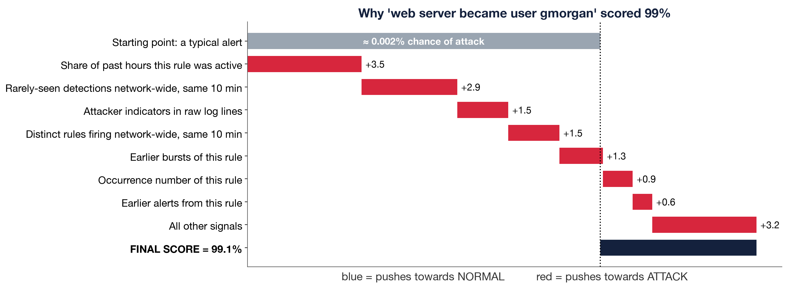

**Rare is not the same as malicious.** An administrator's SSH key login on a mail server uses a rare rule (a
"rarest rule first" detector would flag it), but nothing else is unusual and the log shows a key login, so it scores 0.1%:

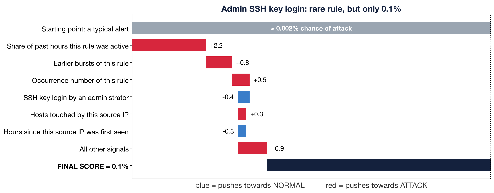

### 8. The local LLM writes the report (it explains, it does not detect)

The machine-learning model scores all 99,161 meta-alerts in seconds. The LLM (**qwen3:14b via Ollama, running on the
laptop, so no data leaves the company**) gets only the top evidence of one incident and writes the report an analyst
would: verdict, timeline, attacker IPs and accounts, MITRE techniques, recommended response. The analyst can also ask
it questions in a chat.

It is kept honest: it may only use the facts we give it, it is told that rare ≠ malicious, and it gets the incident's
confidence tier (HIGH = top score ≥ 0.9 *and* ≥ 2 attack stages). Result: all 9 real attack incidents → TRUE POSITIVE;
all 4 normal incidents → LIKELY BENIGN or NEEDS REVIEW, with the most plausible normal explanation.

### 9. What really matters (ablation)

Remove one group of features, retrain, compare. Knowing only *what* a rule is gives 0.49; knowing *how it behaves in
this network* gives 0.96. Removing the time-window context costs only 0.02, so the model is not just learning when the
attack happened.

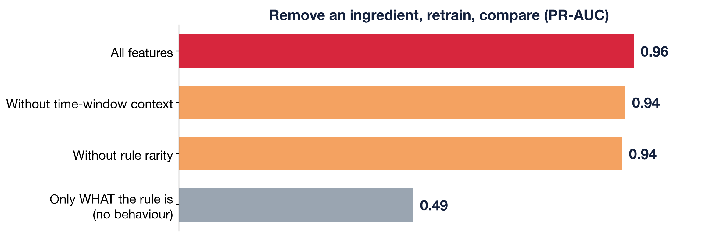

---

## The dashboard

`streamlit run app.py` opens a SOC console. The sidebar has the six views and a network selector that applies to all
of them:

- **Overview**: funnel and comparison with common approaches.
- **Incidents**: ranked incidents with confidence badges, kill-chain timeline, AI report, chat, MITRE techniques, evidence.
- **Why suspicious**: learning period, baseline vs. this alert, SHAP breakdown, the rule's history.
- **Alert queue**: ranked alerts with reasons; mark false positives and the same rule on the same host is suppressed.
- **Threat hunt**: unsupervised hunting over the raw logs. DuckDB profiles every source IP per hour, an Isolation
  Forest flags the outliers, and the analyst sees when they happened, a 3D map, what drove each flag and the top
  source IPs, then gets an AI briefing on the top threat (Gemini if `GEMINI_API_KEY` is in `.env`, otherwise the local
  LLM). Needs the raw dataset in `ait_ads/`.
- **Ground truth**: model risk over time vs. the labeled attack phases (for judges).

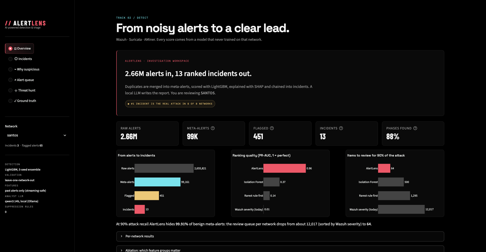

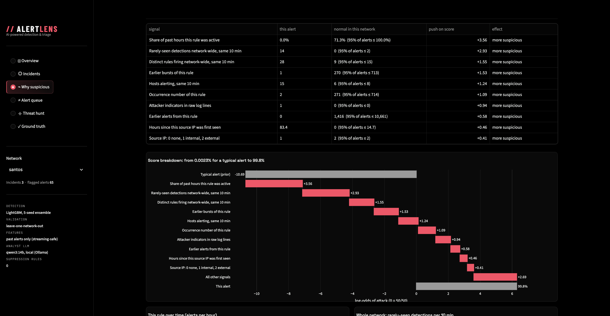

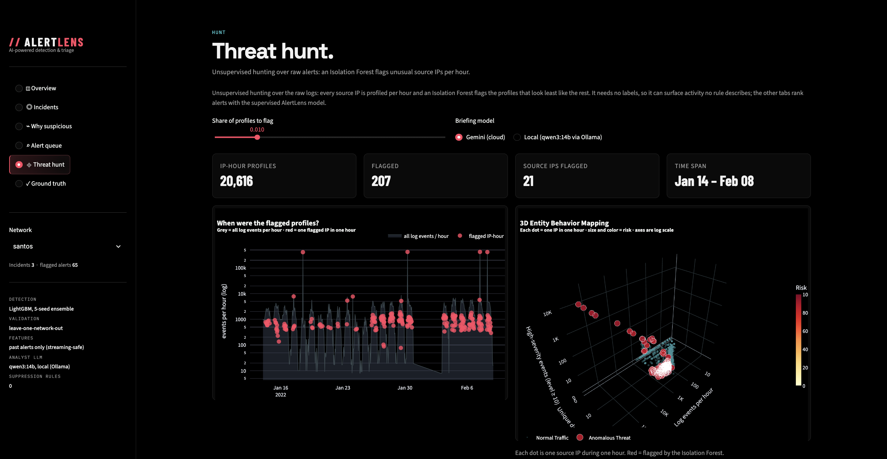

---

## Run it

```bash
python3 -m venv .venv && .venv/bin/pip install -r requirements.txt
.venv/bin/streamlit run app.py            # works right away from the committed results in data/
```

To reproduce everything from the raw alerts, download the AIT Alert Data Set from
[Zenodo](https://zenodo.org/records/8263181) and unpack the 16 `*_wazuh.json` / `*_aminer.json` files into `ait_ads/`:

```bash
ollama pull qwen3:14b                     # optional, for reports and chat
./run_pipeline.sh                         # or run the steps individually
```

Rebuild the slides: `pip install python-pptx`, then `PYTHONPATH=. python presentation/make_figures.py && python presentation/build_deck.py`.

## Where things live

| Step | File |
|---|---|
| Read and normalise the 16 JSON files | `blueteam/ingest.py` |
| Clean labels, meta-alerts, feature calcers | `blueteam/features.py` |
| Train, leave-one-network-out test, baselines, ablation, tuning | `blueteam/train.py` |
| Reasons, attack stage, incidents, confidence tier | `blueteam/explain.py` |
| Learning period, baselines, SHAP breakdown | `blueteam/baseline.py` |
| Local LLM report and chat | `blueteam/llm.py` |
| Ranked alerts and reports as plain files | `blueteam/export.py` → `outputs/ranked_alerts.csv`, `outputs/incident_reports.md` |
| Dashboard | `app.py` |
| Slides and their figures | `presentation/` |

---

## Technical details

<details>
<summary><b>Full results table and how we got from 0.933 to 0.961</b></summary>

| | AlertLens | Isolation Forest | Rule rarity | Wazuh severity (status quo) |
|---|---|---|---|---|
| PR-AUC | **0.961** | 0.366 | 0.143 | 0.006 |
| Precision of top-20 queue | **100%** | 51% | 24% | 1% |
| Items to review to catch 90% of attacks | **64** | 500 | 1,295 | 12,017 |
| Benign meta-alerts suppressed @ 90% recall | **99.9%** | 96.5% | 89.5% | 3.2% |

- 2,655,821 raw alerts → 99,161 meta-alerts → 451 flagged (91% precision) → 13 incidents.
- The #1 incident in all 8 networks is the real multi-step attack (78–100% attack content).
- 88% of attack phases and 91% of attack meta-alerts are surfaced; the kill-chain stage is predicted with 90% accuracy.
- An earlier, untuned version: streaming-safe features 0.933 vs. retrospective (whole 5-day window) 0.938, so going
  live costs almost nothing.

| Step | PR-AUC | Queue @ 90% recall | Flagged false positives |
|---|---|---|---|
| Behavioural calcers, default LightGBM | 0.933 | 84 | 77 |
| + raw-log attacker/admin indicators, account novelty | 0.944 | 91 | 58 |
| + hyperparameter search (16 configs) + 5-seed ensemble | **0.961** | **64** | **41** |

The search accounts for selection bias: for each held-out network we re-pick the config using only the other seven;
that nested estimate is also 0.961 (the same config wins every time). Strong regularisation (`reg_lambda=20`, 30% of
features per tree) is what helped.
</details>

<details>
<summary><b>Labels and denoising</b></summary>

`labels.csv` only gives attack-phase time windows, so ~19K benign background alerts (mail logins, TLS noise) fall
inside them. An in-window alert counts as attack-related only if its rule fires ≥10× more often inside attack windows
than in normal operation for that network. Background rules sit at 1–3×, attack rules at 10²–10⁶×. Labels are used only
to train and to grade, never to score.
</details>

<details>
<summary><b>Raw-log indicators and account novelty</b></summary>

`log_content` reads the raw log lines of every alert in a meta-alert (hex-encoded audit commands are decoded first) and
flags attacker tradecraft (`www-data` switching user, a pty with no login session, commands run from `/var/www` or
`/tmp`, `/etc/shadow` access, `python-requests`/scanner user agents, `.php` in `uploads/`, long encoded payloads) and
admin tradecraft (SSH public-key logins, commands from `/home/*`). `account` asks whether this user account has been
seen on this host or in this network before.
</details>

<details>
<summary><b>Learning period and baseline files</b></summary>

Alerts in the first 24 h are scored but marked "baseline still learning"; only 3 of 451 flagged items fall there, none
of them attacks. `blueteam/baseline.py` builds `data/learning_periods.json`, `feature_baseline.parquet`,
`rule_hourly.parquet`, `network_series.parquet` and `score_breakdown.parquet`. The SHAP breakdown uses the same
held-out-network models that produced the score, so it reproduces every displayed score exactly.
</details>

<details>
<summary><b>Remaining false positives and known limits</b></summary>

Of the 41 flagged benign meta-alerts, 31 sit *inside* labeled attack windows (e.g. "first time this IDS alert is
generated" on the attacker's scan): attack traffic that hit a routinely-firing rule and was denoised away. Counting
them, flagged precision is ~98%. Only 10 flagged items across all 8 networks are outside any attack, mostly "normal
user behaviour" decoys planted by the dataset authors (first-time `sudo`, new login-parameter combinations), which is
what the analyst-feedback suppression handles.

- DNS exfiltration (`dnsteal`) is barely visible: the AMiner DNS high-entropy detector fires all day in normal traffic.
  Next step: per-domain sequence features.
- The HIGH-confidence rule was chosen after seeing these results.
- 8 networks with one attack type; a real deployment needs more attack variety.
</details>
